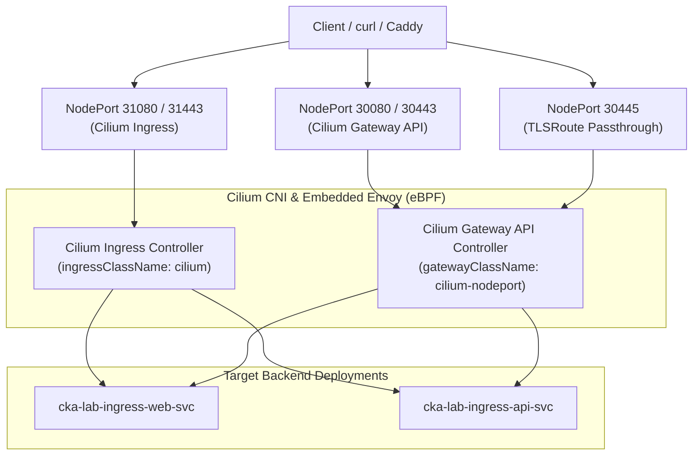

# Implementation Plan: Dual Ingress and Gateway API Management via Cilium

## 1. Problem Statement & Motivation

- **Current Port Collision**: In the current CKA lab setup, Ingress is taught via deprecated community `ingress-nginx`
  (namespace `ingress-nginx`), while Gateway API is taught via `nginx-gateway-fabric` (namespace `nginx-gateway`). Both
  controllers attempt to claim host/NodePorts `30080` (HTTP) and `30443` (HTTPS). As a result, trainees cannot run both
  controllers concurrently and must uninstall one controller to practice the other (`helm uninstall ...`), which
  disrupts drills and prevents unified end-to-end testing.
- **Unified Cilium Architecture**: Cilium is already the cluster CNI and embeds an Envoy proxy data-path. Cilium
  natively implements:
  1. A standard **Kubernetes Ingress Controller** (`networking.k8s.io/v1`).
  2. A **Gateway API Controller** (`gateway.networking.k8s.io/v1`).
- **Goal**: Enable both features concurrently in Cilium so trainees can deploy, inspect, and test standard Ingress
  resources and modern Gateway API routes side-by-side in real time with **zero port collisions**.



---

## 2. Technical Design & Port Allocation Strategy

In Kubernetes, two different `NodePort` services cannot claim the exact same port on the node. Based on user design
specifications:

| Component | Resource Type | Controller / Class | Service Type | Static / Assigned Ports |
| :--- | :--- | :--- | :--- | :--- |
| **Gateway API** | `gateway.networking.k8s.io/v1` `Gateway` | `gatewayClassName: cilium-nodeport` | `NodePort` (`cilium-gateway-cka-lab-gateway`) | **HTTP: `30080`**, **HTTPS: `30443`**, **TLS Passthrough: `30445`** |
| **Ingress** | `networking.k8s.io/v1` `Ingress` | `ingressClassName: cilium` | `NodePort` (`cilium-ingress`) | **HTTP: `31080`**, **HTTPS: `31443`** |

> [!NOTE]
>
> - **Gateway API on 30080 / 30443 (Dynamic Service Lifecycle)**:
>   Unlike Ingress (which has a single pre-existing global service `cilium-ingress`), the Gateway API controller
>   does not create any Service at `cilium install` time. Instead, when a `Gateway` resource (e.g., `cka-lab-gateway`)
>   is deployed, Cilium dynamically generates the companion Service `cilium-gateway-cka-lab-gateway`.
>   Using `CiliumGatewayClassConfig` (`service.type: NodePort`), the generated service is assigned or patched to static
>   `nodePort: 30080` (HTTP) and `30443` (HTTPS). This is why port flags for Gateway API do not exist in the initial
>   `cilium install` command—they belong to the `Gateway` resource lifecycle.
> - **Ingress on 31080 / 31443 (Global Static Service)**:
>   Configured statically via Cilium Helm values during install
>   (`ingressController.service.insecureNodePort=31080`, `ingressController.service.secureNodePort=31443`), provisioning
>   a permanent shared `cilium-ingress` NodePort Service across the cluster.

---

## 3. Scripts Strategy for `/home/vagrant`

To support both **fresh cluster provisioning** and **in-place upgrades on existing clusters**, we adopt a two-tier
script approach:

### 1. Update Existing `scripts/cni-install-cilium.sh` (Fresh Installs)

- Placed on VMs as `/home/vagrant/cni-install-cilium.sh` during Vagrant provisioning.
- Updates the initial `cilium install` command to include:
  - Gateway API CRDs check & installation (`gateways.gateway.networking.k8s.io`).
  - Standard `kube-proxy` service routing (Option 2 baseline, ensuring zero-deadlock cluster bootstrapping).
  - `--set ingressController.enabled=true`
  - `--set ingressController.default=true`
  - `--set ingressController.loadbalancerMode=shared`
  - `--set ingressController.service.type=NodePort`
  - `--set ingressController.service.insecureNodePort=31080`
  - `--set ingressController.service.secureNodePort=31443`
  - `--set gatewayAPI.enabled=true`
- Automatically applies the `CiliumGatewayClassConfig` and `GatewayClass` (`cilium-nodeport`).
- Note: Option 3 ("Halloween Network Upgrade Trick" enabling full `kubeProxyReplacement=true` with explicit
  `k8sServiceHost`) is preserved as an upcoming roadmap upgrade once the base homelab configuration is finalized.

### 2. Create New Script `scripts/cni-enable-ingress-gateway.sh` (In-Place Upgrades)

- Placed on VMs as `/home/vagrant/cni-enable-ingress-gateway.sh` and symlinked to
  `/home/vagrant/cka/helm/enable-cilium-ingress-gateway.sh`.
- Purpose: Safely upgrades an already-running Cilium deployment in-place without deleting pods or
  resetting cluster state.
- Steps executed by the script:
  1. Installs Gateway API standard CRDs if missing (`kubectl apply -f https://...`).
  2. Executes `cilium upgrade --reuse-values` (or `helm upgrade cilium cilium/cilium --reuse-values`) passing the
     ingress and gatewayAPI flags.
  3. Deploys the `CiliumGatewayClassConfig` (`cilium-nodeport`) and `GatewayClass` (`cilium-nodeport`).
  4. Waits for `cilium status --wait` to ensure operator and agent rollouts are healthy.
  5. Displays active IngressClass and GatewayClass verification status.

---

## 4. Required Configuration Changes

### Phase A: Cilium Helm & Ansible Configuration

1. **Variables (`group_vars/all.yml` & `roles/cilium/defaults/main.yml`)**:
   - `cilium_ingress_enabled: true`
   - `cilium_ingress_default: true`
   - `cilium_ingress_service_type: "NodePort"`
   - `cilium_ingress_http_port: 31080`
   - `cilium_ingress_https_port: 31443`
   - `cilium_gateway_api_enabled: true`
   - `cilium_gateway_api_host_network: false`
   - `cilium_gateway_http_nodeport: 30080`
   - `cilium_gateway_https_nodeport: 30443`

2. **Ansible Role Tasks (`roles/cilium/tasks/main.yml`)**:
   - Ensure official Gateway API standard CRDs are applied prior to Cilium rollout.
   - Configure Cilium install parameters with the specified ports.
   - Deploy `CiliumGatewayClassConfig` and `GatewayClass` templates in `kube-system`.

### Phase B: Gateway API NodePort Class Definition (`CiliumGatewayClassConfig`)

```yaml
apiVersion: cilium.io/v2alpha1
kind: CiliumGatewayClassConfig
metadata:
  name: cilium-nodeport
  namespace: kube-system
spec:
  service:
    type: NodePort
---
apiVersion: gateway.networking.k8s.io/v1
kind: GatewayClass
metadata:
  name: cilium-nodeport
spec:
  controllerName: io.cilium/gateway-controller
  parametersRef:
    group: cilium.io
    kind: CiliumGatewayClassConfig
    name: cilium-nodeport
    namespace: kube-system
```

### Phase C: CKA Lab Scenario Updates (`roles/cka_lab`)

1. **`02-ingresses/`**:
   - Update `cka-lab-ingress.yaml.j2` to use `ingressClassName: cilium`.
   - Update `test-ingress.sh.j2`: verifies reachability through `cilium-ingress` on port `31080` (HTTP) and `31443`
     (HTTPS).
   - Remove the conflict prompt warning about uninstalling NGINX Gateway Fabric.

2. **`03-gateway-api/`**:
   - Update `cka-lab-gateway.yaml.j2`: set `gatewayClassName: cilium-nodeport`.
   - Update `test-gateway.sh.j2`: reaches Gateway on NodePort `30080` (HTTP), `30443` (HTTPS), and `30445` (TLS
     Passthrough), applying nodePort patch if needed to ensure deterministic binding.
   - Remove the conflict prompt warning about uninstalling Ingress-NGINX.

3. **`02-helm/`**:
   - Add installer/helper script `enable-cilium-ingress-gateway.sh`.
   - Keep `install-deprecated-nginx-ingress.sh` and `install-nginx-gateway-fabric.sh` for optional comparative drills.

4. **Documentation**:
   - Update `networking_readme.md.j2`: explain Cilium's dual-engine mode, how Ingress and Gateway API run side-by-side,
     exam relevance (how CKA tests both, what keywords to search in docs), and curl verification commands on both
     `30080` (Gateway API) and `31080` (Ingress).

---

## 5. Verification & Validation Steps

1. **CRD & Controller Health**:
   - Verify `kubectl get crd gateways.gateway.networking.k8s.io`
   - Verify `kubectl get gatewayclasses` displays `cilium-nodeport` and `cilium`.
   - Verify `kubectl get ingressclasses` displays `cilium`.

2. **Dual-Stack Reachability**:
   - Apply `02-ingresses/` manifests:
     `curl -H "Host: cka-lab.example.local" http://<NODE_IP>:31080/web` -> returns `200 OK`.
     `curl -H "Host: cka-lab.example.local" http://<NODE_IP>:31080/api` -> returns `200 OK`.
   - Simultaneously apply `03-gateway-api/` manifests:
     `curl -H "Host: httpbin.example.local" http://<NODE_IP>:30080/` -> returns `200 OK`.
     `curl -H "Host: httpbin.example.local" -H "version: 2"` \
       `"http://<NODE_IP>:30080/api/v2?env=canary"` -> returns `200 OK`.
   - Run `test-networking-drills.sh`: All 5 networking drills pass sequentially without uninstalling any controllers.

3. **Quality Gates**:
   - `python3 scripts/check-readme-line-length.py` (strict 120-char line limit).
   - `yamllint`, `shellcheck`, and `ansible-lint`.
