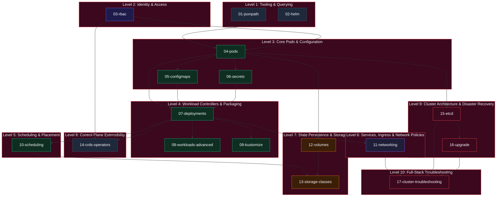

# Plan: CKA Lab Directory Numbering & Pedagogical Dependency Hierarchy

**Target Root Directory:** `/home/vagrant/cka/` on `kube-control-plane`  
**Ansible Role:** `k8s-homelab/roles/cka_lab/`  
**Curriculum Alignment:** CNCF Certified Kubernetes Administrator (CKA) Domains  

---

## 1. Executive Summary & Problem Statement

Currently, the CKA lab exercises under `/home/vagrant/cka/` are unnumbered and listed alphabetically:

```text
/home/vagrant/cka/
├── cluster-troubleshooting/
├── configmaps/
├── crds-operators/
├── deployments/
├── etcd/
├── helm/
├── jsonpath/
├── kustomize/
├── networking/
├── pods/
├── rbac/
├── scheduling/
├── secrets/
├── storage-classes/
├── upgrade/
├── volumes/
└── workloads-advanced/
```

### The Pedagogical Challenge

Alphabetical sorting presents several learning and operational difficulties:

1. **Premature Exposure to High-Complexity Topics**: `cluster-troubleshooting` appears first alphabetically, despite being the ultimate capstone exercise requiring mastery of all control plane and node components.
2. **Inverted Dependency Order**:
   - `configmaps` and `secrets` appear before `pods`, yet understanding how to inject configuration requires first understanding the pod specification and container lifecycle.
   - `deployments` appear before `pods`, yet deployments are controllers managing replica sets of pods.
   - `storage-classes` with delayed binding (`WaitForFirstConsumer`) appears before foundational static `volumes` and `scheduling`.
3. **No Clear Linear Training Progression**: Candidates preparing for the CKA exam lack a guided, step-by-step path starting from rapid CLI query ergonomics and advancing incrementally to full cluster disaster recovery.

### The Solution

Restructure `/home/vagrant/cka/` into a zero-padded, 2-digit numbered sequence (`01-` through `17-`). The numbering reflects **strictly increasing architectural complexity** and honors **hard conceptual prerequisites**. Backward compatibility is preserved through symlinks.

---

## 2. Dependency Graph & Curriculum Progression



---

## 3. Ordered Curriculum Breakdown & Complexity Rationale

| Index | Proposed Directory Name | Primary CKA Domain | Complexity | Prerequisites / Dependencies | Rationale & Exam Objective |
| :--- | :--- | :--- | :--- | :--- | :--- |
| **01** | `01-jsonpath/` | Exam Tooling / CLI | Beginner | Basic `kubectl` CLI | **Fast Querying & Filtering**: In the exam, candidates must extract node IPs, container images, and resource statuses in seconds. Practicing JSONPath and custom columns first establishes the muscle memory required for inspecting all subsequent resources. |
| **02** | `02-helm/` | Exam Tooling / Packaging | Beginner | `01-jsonpath` | **Addons & Tool Deployment**: Deploying cluster add-ons (Metrics Server, Prometheus) via Helm repositories, parameter overrides (`--set`), and chart inspection. |
| **03** | `03-rbac/` | Cluster Architecture (25%) | Intermediate | Cluster API access | **Identity & Access Control**: Certificates, CertificateSigningRequests (CSRs), Role, ClusterRole, RoleBinding, and ClusterRoleBinding. Defines security context and namespace boundaries required before deploying workloads. |
| **04** | `04-pods/` | Workloads & Scheduling (15%) | Intermediate | `01-jsonpath`, `03-rbac` | **Atomic Workload Unit**: Pod specifications, lifecycle phases, init containers, readiness/liveness/startup probes, multi-container communication, and spec immutability. |
| **05** | `05-configmaps/` | Workloads & Scheduling (15%) | Intermediate | `04-pods` | **Configuration Decoupling**: Key-value injection via `valueFrom`, bulk binding with `envFrom`, directory mounts, single-file `subPath` projections, and immutability. |
| **06** | `06-secrets/` | Workloads & Scheduling (15%) | Intermediate | `04-pods`, `05-configmaps` | **Confidentiality & Credentials**: Opaque, TLS, and docker-registry secrets, base64 encoding/decoding, file permission hardening (`defaultMode: 0400`), and volume consumption. |
| **07** | `07-deployments/` | Workloads & Scheduling (15%) | Intermediate | `04-pods`, `05-configmaps`, `06-secrets` | **Stateless Workload Controller**: ReplicaSets, imperative creation/scaling, rolling updates, rollbacks, strategy tuning (`maxSurge`, `maxUnavailable`, `Recreate`), and atomic batch updates via pause/resume. |
| **08** | `08-workloads-advanced/` | Workloads & Scheduling (15%) | Advanced | `04-pods`, `07-deployments` | **Specialized Controllers**: DaemonSets (node-level agents), batch Jobs (run-to-completion tasks with parallelism), and CronJobs (scheduled batch automation). |
| **09** | `09-kustomize/` | Workloads & Scheduling (15%) | Intermediate | `05-configmaps`, `06-secrets`, `07-deployments` | **Declarative Customization**: Base manifests, overlays (`development`, `production`), patches, and resource generators without template engines. |
| **10** | `10-scheduling/` | Workloads & Scheduling (15%) | Advanced | `04-pods`, `07-deployments` | **Pod Placement & Node Topology**: Taints and tolerations, nodeAffinity (hard vs soft), podAffinity/podAntiAffinity, PriorityClasses, preemption, and manual node binding. |
| **11** | `11-networking/` | Services & Networking (20%) | Advanced | `04-pods`, `07-deployments` | **Traffic Routing & Isolation**: ClusterIP, NodePort, LoadBalancer, Ingress controllers, Gateway API, CoreDNS break-fix, and zero-trust microsegmentation via NetworkPolicies. |
| **12** | `12-volumes/` | Storage (10%) | Advanced | `04-pods` | **Static Storage & Access Modes**: `emptyDir` (scratch and RAM memory), `hostPath`, static PersistentVolumes (PV) and Claims (PVC), access modes (RWO, RWX), and reclaim policy mutation (`Retain` vs `Delete`). |
| **13** | `13-storage-classes/` | Storage (10%) | Very Advanced | `10-scheduling`, `12-volumes` | **Dynamic Storage Provisioning**: StorageClasses, CSI plugins (NFS, Ceph), dynamic PVC binding, `WaitForFirstConsumer` delayed topological scheduling, and online PVC capacity expansion. |
| **14** | `14-crds-operators/` | Cluster Architecture (25%) | Very Advanced | `03-rbac`, `07-deployments` | **API Extensibility**: CustomResourceDefinitions, OpenAPI v3 schema validation, custom controller reconciliation patterns, and operator lifecycles. |
| **15** | `15-etcd/` | Cluster Architecture (25%) | Very Advanced | `03-rbac`, `04-pods` (static pods) | **Disaster Recovery**: `etcdctl` v3 snapshots, static pod TLS certificate discovery, backup verification, and cluster recovery procedures. |
| **16** | `16-upgrade/` | Cluster Architecture (25%) | Very Advanced | `03-rbac`, `15-etcd` | **Cluster Lifecycle & Maintenance**: `kubeadm` control plane and worker upgrades, `kubelet`/`kubectl` version skew handling, and node `cordon`/`drain`/`uncordon`. |
| **17** | `17-cluster-troubleshooting/` | Troubleshooting (30%) | Capstone | Synthesizes 01 through 16 | **Full-Stack Cluster Autopsy**: Dead kubelet triage, control plane static pod crash diagnosis, expired certificates, CNI failure recovery, and broken DNS resolution. |

---

## 4. Architectural Implementation & Migration Strategy

To implement this numbering without breaking existing automation, references, or user habits, the migration will follow these architectural rules:

### A. Backward-Compatible Symlinks

For every numbered directory, a symlink pointing from the unnumbered name will be created at `/home/vagrant/cka/`:

```text
/home/vagrant/cka/
├── 01-jsonpath/
├── 02-helm/
├── 03-rbac/
├── ...
├── jsonpath -> 01-jsonpath
├── helm -> 02-helm
├── rbac -> 03-rbac
└── create-user-context.sh -> 03-rbac/create-user-context.sh
```

This guarantees that:

- Any existing scripts invoking `~/cka/rbac/create-user-context.sh` or `~/cka/helm/...` continue to work without disruption.
- Autocompletion in bash works immediately with both `cd ~/cka/03<TAB>` and `cd ~/cka/rb<TAB>`.

### B. Ansible Monorepo Modifications

1. **Role Defaults (`k8s-homelab/roles/cka_lab/defaults/main.yml`)**:
   - Update all `cka_lab_*_dir` variables to point to the new numbered paths:
     - `cka_lab_jsonpath_dir: "/home/{{ ansible_user | default('vagrant') }}/cka/01-jsonpath"`
     - `cka_lab_helm_dir: "/home/{{ ansible_user | default('vagrant') }}/cka/02-helm"`
     - `cka_lab_rbac_dir: "/home/{{ ansible_user | default('vagrant') }}/cka/03-rbac"`
     - `cka_lab_pods_dir: "/home/{{ ansible_user | default('vagrant') }}/cka/04-pods"`
     - `cka_lab_configmaps_dir: "/home/{{ ansible_user | default('vagrant') }}/cka/05-configmaps"`
     - `cka_lab_secrets_dir: "/home/{{ ansible_user | default('vagrant') }}/cka/06-secrets"`
     - `cka_lab_deployments_dir: "/home/{{ ansible_user | default('vagrant') }}/cka/07-deployments"`
     - `cka_lab_workloads_advanced_dir: "/home/{{ ansible_user | default('vagrant') }}/cka/08-workloads-advanced"`
     - `cka_lab_kustomize_dir: "/home/{{ ansible_user | default('vagrant') }}/cka/09-kustomize"`
     - `cka_lab_scheduling_dir: "/home/{{ ansible_user | default('vagrant') }}/cka/10-scheduling"`
     - `cka_lab_networking_dir: "/home/{{ ansible_user | default('vagrant') }}/cka/11-networking"`
     - `cka_lab_volumes_dir: "/home/{{ ansible_user | default('vagrant') }}/cka/12-volumes"`
     - `cka_lab_storage_classes_dir: "/home/{{ ansible_user | default('vagrant') }}/cka/13-storage-classes"`
     - `cka_lab_crds_dir: "/home/{{ ansible_user | default('vagrant') }}/cka/14-crds-operators"`
     - `cka_lab_etcd_dir: "/home/{{ ansible_user | default('vagrant') }}/cka/15-etcd"`
     - `cka_lab_upgrade_dir: "/home/{{ ansible_user | default('vagrant') }}/cka/16-upgrade"`
     - `cka_lab_cluster_troubleshooting_dir: "/home/{{ ansible_user | default('vagrant') }}/cka/17-cluster-troubleshooting"`

2. **Scenario Tasks (`k8s-homelab/roles/cka_lab/tasks/scenario_*.yml`)**:
   - Update directory creation and template paths to use the centralized `cka_lab_*_dir` variables.
   - Add compatibility symlink tasks linking the legacy directory name to the numbered directory.

3. **Master CKA Index Guide (`/home/vagrant/cka/README.md`)**:
   - Provide a master index listing all 17 chapters in ordered sequence with domain badges and direct links.

4. **Documentation & Quality Gates**:
   - Update `k8s-homelab/roles/cka_lab/README.md` and `AGENTS.md`.
   - Update `k8s-homelab/CHANGELOG.md` under `## [Unreleased]`.
   - Verify all Ansible linters (`yamllint`, `shellcheck`, `markdownlint-cli2`, `ansible-lint`).

---

## 5. Review & Execution Decision

This plan can be executed immediately or reviewed in your IDE.
To proceed with implementation, confirm approval.
