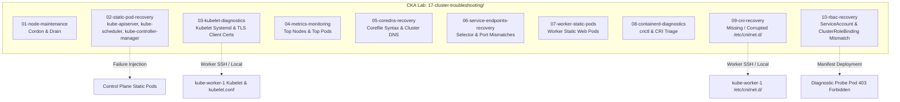

# CKA Troubleshooting Scenarios: Gap Analysis & Implementation Plan

This document establishes the architecture, component gap analysis, and implementation roadmap for expanding the
**CKA Training Lab (`roles/cka_lab`)** with comprehensive troubleshooting scenarios covering Control Plane static
pods, Worker Node Kubelet & TLS certificates, Cluster CNI & CoreDNS, and ServiceAccount/RoleBinding RBAC mismatches.

---

## 1. Scenario Coverage & Gap Analysis

| Category | Target Component | Exam Scenario | Current Status in `cka_lab` | Planned Action |
| --- | --- | --- | --- | --- |
| **1. Control Plane** | `kube-apiserver` | Broken Command Flag (`--authorisation-mode`) & Certificate Path | **Partial**: `02-static-pod-recovery/break-apiserver.sh` only tests invalid etcd CA path | **Enhance**: Add `--scenario=flag` (`--authorisation-mode`) and `--scenario=etcd` with automated recovery |
| **1. Control Plane** | `kube-controller-manager` | Misconfigured Kubeconfig / Port | **Missing**: Only `kube-scheduler` is implemented in `02-static-pod-recovery/` | **Implement**: Add `break-controller-manager.sh`, `fix-controller-manager.sh`, and ReplicaSet reconciliation probe |
| **1. Control Plane** | `kube-scheduler` | Broken Kubeconfig / Mount / Syntax | **Implemented**: `02-static-pod-recovery/break-scheduler.sh` with canary deployment probe | **Validate**: Ensure test suite runs non-interactively |
| **2. Worker Node** | `kubelet` Service | Corrupted Systemd / Config (`config.yaml`) | **Partial**: `03-kubelet-diagnostics/` only breaks control plane local kubelet | **Enhance**: Add multi-node targeting (`--target=worker1`), driving `kube-worker-1` into `NotReady` |
| **2. Worker Node** | `kubelet` TLS Certs | Wrong Client Certificate Path in `kubelet.conf` | **Missing**: No certificate authentication failure drill | **Implement**: Add `break-kubelet-cert.sh` & `fix-kubelet-cert.sh` simulating TLS auth failure in `journalctl` |
| **3. Cluster Network** | `coredns` | Broken Corefile Syntax / Upstream Proxy | **Implemented**: `05-coredns-recovery/break-coredns.sh` and `test-dns-resolution.sh` | **Validate**: Expand assertion to test cluster-internal DNS name (`kubernetes.default.svc.cluster.local`) |
| **3. Cluster Network** | `cni` Plugin | Missing / Corrupted `/etc/cni/net.d/` Config | **Missing**: No CNI plugin failure drill | **Implement**: New drill `09-cni-recovery/` targeting `kube-worker-1` causing `ContainerCreating` |
| **4. Security & Access** | `rbac` ServiceAccount | ServiceAccount / RoleBinding Namespace or Name Mismatch | **Missing**: `03-rbac` only creates working SAs; no broken binding triage | **Implement**: New drill `10-rbac-recovery/` simulating `403 Forbidden` on cluster metrics probe |

---

## 2. Architectural Blueprint



---

## 3. Detailed Implementation Specifications

### Category 1: Master Node (Control Plane) Scenarios

#### 1.1 `kube-apiserver` Broken Flag & Certificate Drill

- **Directory**: `17-cluster-troubleshooting/02-static-pod-recovery/`
- **Files**:
  - `break-apiserver.sh`: Supports `--scenario=flag` (injects typo `--authorisation-mode=Node,RBAC`) and
    `--scenario=etcd` (corrupts `--etcd-cafile=/etc/kubernetes/pki/etcd/ca-broken.crt`).
  - `fix-apiserver.sh`: Reverts modifications using stored `.bak` or clean sed replacement; polls `kubectl get --raw
    /healthz` until 200 OK.
- **Symptom**: `kubectl get nodes` returns:

  ```text
  The connection to the server 127.0.0.1:6443 was refused - did you specify the right host or port?
  ```

- **Triage Workflow**:

  ```bash
  sudo crictl ps -a | grep -i apiserver
  sudo crictl logs <container_id>
  # OR inspect host pod log directly:
  sudo tail -n 50 /var/log/pods/kube-system_kube-apiserver-*/kube-apiserver/*.log
  ```

#### 1.2 `kube-controller-manager` Misconfiguration Drill

- **Directory**: `17-cluster-troubleshooting/02-static-pod-recovery/`
- **Files**:
  - `break-controller-manager.sh`: Corrupts `--kubeconfig=/etc/kubernetes/controller-manager-broken.conf` or hostPath
    volume mount in `/etc/kubernetes/manifests/kube-controller-manager.yaml`.
  - `fix-controller-manager.sh`: Restores valid kubeconfig path and verifies static pod container is Running via `crictl
    ps`.
  - `canary-replicaset.yaml`: Canary Deployment testing controller manager functionality.
- **Symptom**: `kubectl create deployment test --replicas=3` creates the Deployment, but the ReplicaSet controller
  never provisions underlying Pods (desired replicas: 3, current: 0).
- **Triage Workflow**:

  ```bash
  sudo crictl ps -a | grep -i controller-manager
  sudo crictl logs <container_id>
  kubectl get componentstatuses # (or kubectl get pods -n kube-system)
  ```

---

### Category 2: Worker Node (Kubelet & Runtime) Scenarios

#### 2.1 Kubelet Systemd & Configuration Failure on Worker Node

- **Directory**: `17-cluster-troubleshooting/03-kubelet-diagnostics/`
- **Files**:
  - `break-worker-kubelet.sh`: Uses SSH or local worker execution to modify `/var/lib/kubelet/config.yaml` or
    `/etc/kubernetes/kubelet.env` (e.g. invalid `cgroupDriver` or misspelled `containerRuntimeEndpoint`).
  - `fix-worker-kubelet.sh`: Restores valid configuration and runs `systemctl daemon-reload && systemctl restart
    kubelet`.
- **Symptom**: `kubectl get nodes` displays `kube-worker-1` in `NotReady` state.
- **Triage Workflow**:

  ```bash
  ssh kube-worker-1
  sudo systemctl status kubelet
  sudo journalctl -u kubelet -n 50 --no-pager
  ```

#### 2.2 Wrong Client Certificate Path in `kubelet.conf`

- **Directory**: `17-cluster-troubleshooting/03-kubelet-diagnostics/`
- **Files**:
  - `break-kubelet-cert.sh`: Moves `/var/lib/kubelet/pki/kubelet-client-current.pem` to `kubelet-client-current.pem.bak`
    (or patches `client-certificate: ...` in `/etc/kubernetes/kubelet.conf` to a non-existent path).
  - `fix-kubelet-cert.sh`: Restores the valid client certificate path and restarts Kubelet.
  - `test-kubelet-cert.sh`: Non-interactive drill verifying failure detection and recovery.
- **Symptom**: Node transitions to `NotReady`. `journalctl -u kubelet` logs:

  ```text
  Unable to authenticate to the Kubernetes API: x509: certificate signed by unknown authority
  # OR:
  open /var/lib/kubelet/pki/kubelet-client-current.pem: no such file or directory
  ```

- **Triage Workflow**:

  ```bash
  sudo journalctl -u kubelet -e | grep -E "x509|certificate|tls|token"
  sudo grep -i client-certificate /etc/kubernetes/kubelet.conf
  ```

---

### Category 3: Cluster Network (CNI & DNS) Scenarios

#### 3.1 CoreDNS Deployment Misconfiguration

- **Directory**: `17-cluster-troubleshooting/05-coredns-recovery/`
- **Status**: Already scaffolded with `break-coredns.sh` and `fix-coredns.sh`.
- **Enhancement**:
  - Update `test-dns-resolution.sh` to explicitly probe both external DNS (`1.1.1.1`) and in-cluster service resolution
    (`kubernetes.default.svc.cluster.local`).
  - Verify CoreDNS pod logs display the exact syntax failure:

    ```bash
    kubectl logs -n kube-system -l k8s-app=kube-dns
    ```

#### 3.2 Missing or Corrupted CNI Plugin Configuration

- **Directory**: `17-cluster-troubleshooting/09-cni-recovery/`
- **Files**:
  - `break-cni.sh`: Backs up and renames `/etc/cni/net.d/05-cilium.conflist` (or CNI config) on `kube-worker-1` to
    `/etc/cni/net.d/05-cilium.conflist.bak`.
  - `cni-probe-pod.yaml`: Targeted probe pod with `nodeSelector: kubernetes.io/hostname: kube-worker-1`.
  - `fix-cni.sh`: Restores `/etc/cni/net.d/05-cilium.conflist` and waits for Kubelet CNI sync.
  - `test-cni-recovery.sh`: Automated verification script asserting pod transitions from `ContainerCreating` to
    `Running`.
  - `README.md`: Step-by-step diagnostic guide.
- **Symptom**: Newly scheduled pods on `kube-worker-1` remain in `ContainerCreating`. `kubectl describe pod` events
  show:

  ```text
  Warning FailedCreatePodSandBox Failed to create pod sandbox: networkPlugin cni failed to set up pod network
  ```

- **Triage Workflow**:

  ```bash
  kubectl describe pod <probe-pod>
  ssh kube-worker-1 "ls -la /etc/cni/net.d/"
  ssh kube-worker-1 "sudo journalctl -u kubelet -n 50 | grep -i cni"
  ```

---

### Category 4: Security & Access Control (RBAC) Scenarios

#### 4.1 ServiceAccount & RoleBinding / ClusterRoleBinding Mismatch

- **Directory**: `17-cluster-troubleshooting/10-rbac-recovery/` (with cross-reference in `03-rbac/`)
- **Files**:
  - `01-rbac-probe-setup.yaml`: Creates namespace `security-ops`, ServiceAccount `node-inspector`, and ClusterRole
    `node-reader` with `get, list` permissions on `nodes`.
  - `02-broken-binding.yaml`: Binds `node-reader` to ServiceAccount `node-inspectr` (misspelled name) or subject
    namespace `default` instead of `security-ops`.
  - `03-fixed-binding.yaml`: Corrects the `subjects[0].name` and `subjects[0].namespace` to match
    `security-ops:node-inspector`.
  - `probe-pod.yaml`: Diagnostic pod using `curlimages/curl` or `bitnami/kubectl` making API requests using the pod's
    service account token.
  - `test-rbac-recovery.sh`: Automated test runner verifying `403 Forbidden` initially and `200 OK` after applying fix.
  - `README.md`: Troubleshooting guide using `kubectl describe clusterrolebinding` and `kubectl auth can-i`.
- **Symptom**: Pod crashes or logs:

  ```text
  Error from server (Forbidden): nodes is forbidden: User "system:serviceaccount:security-ops:node-inspector"
  cannot list resource "nodes" in API group "" at the cluster scope
  ```

- **Triage Workflow**:

  ```bash
  kubectl logs -n security-ops pod/node-inspector-pod
  kubectl describe clusterrolebinding node-reader-binding
  kubectl auth can-i list nodes --as=system:serviceaccount:security-ops:node-inspector
  ```

---

## 4. Master Test Runner Integration

Update `test-cluster-troubleshooting.sh` to execute the expanded suite in sequence:

```bash
# Drill 1: Node Maintenance (Cordon & Drain)
# Drill 2: Static Pod Recovery (apiserver, scheduler, controller-manager)
# Drill 3: Kubelet Diagnostics & Client Certs (service restart & TLS auth)
# Drill 4: Cluster Resource Metrics (kubectl top)
# Drill 5: CoreDNS Resolution & Corefile Recovery
# Drill 6: Service & Endpoints Triage
# Drill 7: Worker Static Pods
# Drill 8: Container Runtime Diagnostics (crictl)
# Drill 9: CNI Network Plugin Diagnostics (/etc/cni/net.d/)
# Drill 10: RBAC ServiceAccount & RoleBinding Alignment
```

---

## 5. File Inventory & Ansible Role Updates

### New Templates to Author in `roles/cka_lab/templates/`

1. `cluster_troubleshooting_02_break_controller_manager.sh.j2`
2. `cluster_troubleshooting_02_fix_controller_manager.sh.j2`
3. `cluster_troubleshooting_03_break_kubelet_cert.sh.j2`
4. `cluster_troubleshooting_03_fix_kubelet_cert.sh.j2`
5. `cluster_troubleshooting_09_cni_readme.md.j2`
6. `cluster_troubleshooting_09_cni_break.sh.j2`
7. `cluster_troubleshooting_09_cni_fix.sh.j2`
8. `cluster_troubleshooting_09_cni_probe.yaml.j2`
9. `cluster_troubleshooting_09_cni_test.sh.j2`
10. `cluster_troubleshooting_10_rbac_readme.md.j2`
11. `cluster_troubleshooting_10_rbac_setup.yaml.j2`
12. `cluster_troubleshooting_10_rbac_fix.yaml.j2`
13. `cluster_troubleshooting_10_rbac_probe.yaml.j2`
14. `cluster_troubleshooting_10_rbac_test.sh.j2`

### Existing Files to Modify

1. `roles/cka_lab/tasks/scenario_cluster_troubleshooting.yml`: Register directories `09-cni-recovery` and
   `10-rbac-recovery`, and add all 14 new templates to the deployment loop.
2. `roles/cka_lab/templates/cluster_troubleshooting_02_break_apiserver.sh.j2`: Add `--scenario=flag` flag typo mode
   alongside `--scenario=etcd`.
3. `roles/cka_lab/templates/cluster_troubleshooting_readme.md.j2`: Document Sections 9 and 10, update scenario directory
   tree, and expand exam lookup tables.
4. `roles/cka_lab/templates/cluster_troubleshooting_test_drills.sh.j2`: Integrate drills 9 and 10 into the automated
   test runner.
5. `roles/cka_lab/README.md`: Update Chapter 17 scenario summary and verification commands.
6. `k8s-homelab/CHANGELOG.md`: Record the new troubleshooting scenarios under `## [Unreleased]`.

---

## 6. Execution & Quality Gates Roadmap

### Step 1: Template Authoring & Enhancements

- Enhance `break-apiserver.sh` and add `controller-manager` scripts in Section 2.
- Implement Kubelet certificate failure drill in Section 3.
- Author CNI recovery templates in Section 9.
- Author RBAC recovery templates in Section 10.

### Step 2: Ansible Tasks & Defaults Integration

- Update `roles/cka_lab/tasks/scenario_cluster_troubleshooting.yml`.
- Verify variables in `roles/cka_lab/defaults/main.yml`.

### Step 3: Linting & Validation Gates

- **ShellCheck**: `shellcheck -s bash` across all new `.sh.j2` templates with defensive flags (`set -euo pipefail`).
- **Markdown Line Length**: Strict 120-character maximum line length verified via
  `python3 scripts/check-readme-line-length.py`.
- **Markdown Lint**: `markdownlint-cli2` across all modified documentation.
- **YAML Lint**: `yamllint -c .yamllint` on all Ansible tasks and manifests.
- **Ansible Lint**: Zero failures and zero warnings under `production` profile via:

  ```bash
  nix shell nixpkgs#ansible-lint --command bash -c \
    "ANSIBLE_ROLES_PATH=k8s-homelab/roles ansible-lint -c k8s-homelab/.ansible-lint k8s-homelab/playbooks/site.yml"
  ```
